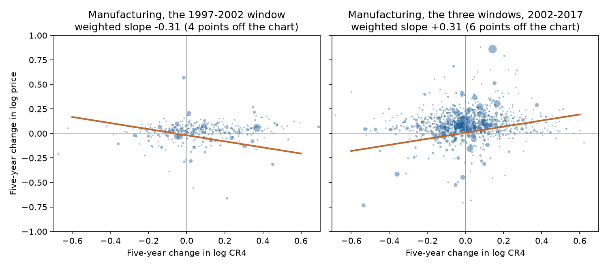
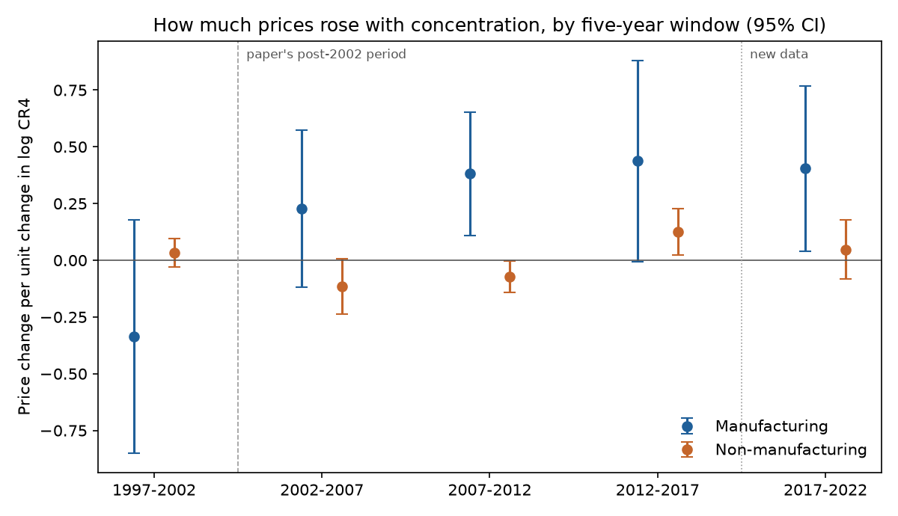

# Where Fewer Sellers Mean Higher Prices

### In 2020, Matias Covarrubias, Germán Gutiérrez and Thomas Philippon argued that after 2002 American concentration turned from the kind that lowers prices into the kind that raises them. With the 2022 Census, I asked again.

---

Between 2012 and 2017 the four largest companies in American pharmaceutical manufacturing, an industry led by Pfizer,
Merck, Johnson & Johnson and AbbVie, raised their share of what the country's drug plants ship from 37.2% to 43.9%.
Over the same five years the prices those plants charged rose 31.1%, by the Commerce Department's index for the
industry, while prices across the industries in this study rose 1.4%. Air travel went the same way a few years
earlier. From 2007 to 2012, as Delta absorbed Northwest and United merged with Continental, the top four's share of
the air transportation business, averaged across the Census's five airline industries, rose from 51.2% to 63.4%, and
air transportation prices rose 20.6% against 10.8% for prices generally. Renting out computing power went the other
way. From 2017 to 2022 the four largest firms in data processing and hosting, an industry led by Amazon Web Services,
Microsoft and Google, more than doubled their share from 17.2% to 37.2%, and prices in that industry fell 6.2% while
prices across the study rose 21.0%.

All three markets became more concentrated. In two of them prices outran everything else, and in the third they
fell. That gap is the subject of this repository. When a few firms take over a market, it can be because they are
better and cheaper than the rivals they displace, or because something is keeping new rivals out. The first kind of
concentration should come with falling prices and rising productivity. The second should come with rising prices.
Three economists at New York University tried to tell the two apart across the whole economy, and concluded that the
United States had switched from the first kind to the second around the turn of the century.

---

## Concentration, and what a markup means here

The Census Bureau measures concentration every five years with the four-firm concentration ratio, the share of an
industry's sales made by its four largest companies:

```math
\text{CR4}_{j,t} = \frac{\text{sales of the 4 largest firms in } j}{\text{total sales of industry } j}
```

The paper works with changes in the logarithm of CR4 over five years, which are close to percentage changes for
small moves. For cement between the 2017 and 2022 Censuses:

```math
\Delta_5 \log \text{CR4} = \log\frac{51.7}{40.1} = 0.254, \qquad \Delta_5 \log P = 0.191 \;\;(\text{a } 21.1\% \text{ rise})
```

Here $`P`$ is the industry's price index, so cement's top four raised their share by 29% (0.254 in logs) while
cement prices rose 21%. The three markets below show the range CR4 takes in the 2022 Census.

| Industry | Top four companies' share, 2022 |
|---|---|
| Breakfast cereal manufacturing | 86.6% |
| Cement manufacturing | 51.7% |
| Offices of physicians | 6.2% |

The paper's second measure is a markup over unit labor cost, the price of a product divided by the wages it takes
to make one unit of it. It needs no estimation, because it collapses to revenue per dollar of payroll. With price
$`P`$, real output $`Y`$, wage $`W`$, workers $`L`$, and labor productivity $`LP = Y/L`$:

```math
\begin{aligned}
\mu &\equiv \frac{P}{ULC} = \frac{P}{W/LP} = \frac{P\,Y}{W\,L} = \frac{\text{sales}}{\text{payroll}} \\
\Delta \log \mu &= \Delta \log P - \Delta \log W + \Delta \log LP
\end{aligned}
```

Pharmaceutical preparation plants, the factories run by companies such as Pfizer, Merck and Johnson & Johnson,
shipped $136.5 billion of medicine in 2012 against $12.5 billion of payroll, a ratio of 10.9. By 2017 the figures
were $153.9 billion and $12.2 billion, a ratio of 12.6, so $`\Delta \log \mu = 0.145`$. The level of the ratio means
little, since it ignores materials, capital and research. Its change over five years is what the paper uses.

---

## The paper and its authors

Thomas Philippon is the Max L. Heine Professor of Finance at New York University's Stern School of Business, and in
2019 he published *The Great Reversal*, a book about the growing market power of large American firms. The IMF had
named him one of the 25 leading economists under 45 in 2014. Germán
Gutiérrez, his frequent coauthor at Stern, had written with him on why American business investment stayed weak after
2000 even as profits rose. Matias Covarrubias was at NYU as well. Their paper, "From Good to Bad
Concentration? US Industries over the Past 30 Years," was written for the NBER Macroeconomics Annual conference in
April 2019 and appeared in the volume in 2020.

The paper starts from a simple model of an industry in which firms pay a sunk cost $`\kappa`$ to enter, a fixed cost
$`\phi`$ each period to operate, and charge a markup $`\mu`$ over marginal cost $`1/A`$, where $`A`$ is productivity.
Future profits are discounted at the interest rate $`r`$ plus an exit rate $`\delta`$. Assume $`N`$ identical firms
and demand with unit elasticity, so total spending $`pY = \bar{Y}`$ does not depend on price. Free entry sets the
value of entering equal to its cost:

```math
\begin{aligned}
p &= \frac{1+\mu}{A} \\
\pi &= \Big(p - \frac{1}{A}\Big)\frac{Y}{N} - \phi = \frac{\mu}{1+\mu}\,\frac{\bar{Y}}{N} - \phi \\
\frac{\pi}{r+\delta} &= \kappa
\;\;\Longrightarrow\;\;
N = \frac{\mu}{1+\mu}\cdot\frac{\bar{Y}}{(r+\delta)\,\kappa + \phi}
\end{aligned}
```

Fewer firms means a more concentrated industry, and the formula shows two ways to get there. If competition gets
tougher and $`\mu`$ falls, some firms can no longer cover their costs and leave, $`N`$ falls, and the price $`p`$ falls with it. If instead the cost
of entry $`\kappa`$ rises, $`N`$ falls without any gain in efficiency, and once markups depend on the number of
rivals (the paper writes $`\mu = \bar{l}\,N^{-\theta}`$) the price rises. Concentration and prices move in opposite
directions in the first case and together in the second, so the sign of that co-movement tells you which force is
at work.

The authors ran that test on industries over five-year windows. Before 2002, changes in concentration had almost no
relation to changes in prices. After 2002 the relation turned positive. In their main specification, with
manufacturing at the detailed Census level and services at the level of the Commerce Department's industry accounts,
the price slope before 2002 was −0.01, and the post-2002 interaction was 0.17 with a standard error of 0.04, on 2,083
industry-windows. Markups showed the same shift (0.23). In broad Bureau of Labor Statistics industries, the link
between concentration and productivity growth went from 0.186 before 2000 to −0.044 after. Their reading was that
1990s concentration was driven by efficient leaders such as computer makers, and that concentration since 2000
reflects rising barriers to entry, with telecoms, airlines and banking as their clearest cases.

The strongest objection came from Sharat Ganapati, whose study of the same Census data found that concentration
increases were generally uncorrelated with price changes and positively correlated with productivity, a reading in
which growing firms are mostly good firms. The paper answered that in detailed industries a positive shock to one
large firm raises both concentration and measured output at once, a statistical artifact of how lopsided firm
sizes are. Both sides agree on the raw correlations. They disagree on what to make of them, which is why the question
still matters for every merger review that treats rising concentration as a warning sign.

---

## How I tested it

I followed the paper's own design, Table 3, as closely as public data allow. Concentration comes from the Economic
Census for every 6-digit industry outside agriculture, mining, utilities, construction, finance, real estate lessors
and management of companies, for 1997, 2002, 2007, 2012, 2017 and 2022. Like the paper, I compare each industry only with itself, keeping an industry in a window
when its code maps one-to-one between the two Censuses in the Census Bureau's official concordance, and I keep
taxable firms where the Census splits them out. For manufacturing, prices, shipments, payroll and productivity come
from the NBER-CES Manufacturing Industry Database, as in the paper. For everything else, prices come from the Bureau
of Economic Analysis detailed gross output price indexes, and I average the Census figures up to BEA industries (338
in all) using sales weights. The paper's pre-2002 period began in 1987 with SIC-coded
Census data that I could not obtain as public flat files, so my only pre-2002 window is 1997–2002.

For industry $`j`$ in a five-year window ending in Census year $`t`$, the estimating equation is

```math
\begin{aligned}
\Delta_5 \log P_{jt} ={}& \beta\, \Delta_5 \log \text{CR4}_{jt}
+ \delta\, \big(\Delta_5 \log \text{CR4}_{jt} \times \mathbf{1}[t > 2002]\big) \\
&+ \lambda' X_{jt} + \gamma_{s(j),t} + \varepsilon_{jt},
\qquad H_0:\ \delta = 0
\end{aligned}
```

where $`X_{jt}`$ holds the five-year changes in log labor productivity and log wages (the paper's controls),
$`\gamma_{s(j),t}`$ is a fixed effect for each two-digit sector in each window, and $`\varepsilon_{jt}`$ is the error. The
paper's "bad concentration" claim is $`\delta > 0`$. Each industry is weighted by its sales at the start of the window
(NBER-CES shipments in manufacturing, BEA gross output elsewhere), and standard errors are clustered by industry, as in the paper. The same equation with $`\Delta_5 \log \mu`$ on the left
gives the markup version.

For the extension I used the BEA panel, which covers all industries with the same price source through 2025, and
added the 2017–2022 window that the authors could not see. I allow separate interactions for 2002–2017 and for
2017–2022:

```math
\begin{aligned}
\Delta_5 \log P_{jt} ={}& \beta\, \Delta_5 \log \text{CR4}_{jt}
+ \delta_{1}\, \Delta_5 \log \text{CR4}_{jt}\, \mathbf{1}[2002 < t \le 2017] \\
&+ \delta_{2}\, \Delta_5 \log \text{CR4}_{jt}\, \mathbf{1}[t = 2022]
+ \gamma_{s(j),t} + \varepsilon_{jt},
\qquad H_0:\ \delta_2 = \delta_1
\end{aligned}
```

Here $`\mathbf{1}[\cdot]`$ is an indicator equal to one when the condition holds, and the test is whether the newest
window's interaction $`\delta_2`$ differs from the 2002–2017 interaction $`\delta_1`$.

---

## After 2002, factories that concentrated raised prices

In manufacturing, the paper's result comes through, and more strongly than in the original. The table compares the
post-2002 interaction $`\delta`$ in the specification with controls.

| Post-2002 interaction, price regression | Paper (1987–2012) | This rerun (1997–2017) | Industry-windows in rerun |
|---|---|---|---|
| All industries | 0.17 (0.04) | 0.129 (0.075) | 1,772 |
| Manufacturing | 0.20 (0.06) | 0.392 (0.103) | 1,360 |
| Non-manufacturing | 0.17 (0.05) | −0.030 (0.047) | 412 |

In formal terms, for manufacturing,

```math
\begin{aligned}
\hat\beta &= 0.065\;(0.069) \\
\hat\delta &= 0.392\;(0.103),\quad 95\%\ \text{CI}\ [0.190,\ 0.593],\quad N = 1{,}360
\end{aligned}
```

so the slope after 2002 is $`\hat\beta + \hat\delta = 0.457`$ (0.100). An industry whose top four gained about a tenth
more of the market, an increase in log CR4 of 0.1, saw prices about 4.7% higher over five years than a manufacturing
industry in the same sector whose concentration held still. Without the productivity and wage controls the
interaction is 0.621 (0.295) and the post-2002 slope is 0.311 (0.120). Markups moved the same way, with an interaction
of 0.392 (0.113) and a post-2002 slope of 0.446 (0.098).



The 1997–2002 slope is negative in the weighted data, −0.310, and the reason is the industry the paper itself
singled out. Electronic computer manufacturing, led by Dell, HP, Compaq and Apple, went from a top-four share of 45.4%
to 75.5% while its BEA price index fell 74.5%, which puts it below the bottom edge of the left panel. Dropping that one industry moves the 1997–2002 slope to −0.021 (0.047),
so about half of the measured break rests on how computer prices behaved in a single window (the interaction
without computers is 0.318, in the next table).

Outside manufacturing the shift does not appear. Service industries show no break after 2002, with or without
controls, and their markups show none either. The paper found its strongest markup effect in services. In this public version of the data, the post-2002
change is confined to manufacturing.

---

## The pattern lives in the largest manufacturers

The paper weights industries by sales, which gives a few giant industries most of the influence. Petroleum
refining alone is 4% to 14% of the manufacturing sample's start-of-window shipments, and its prices swing with crude
oil. I checked how much the result depends on such industries.

| Post-2002 interaction, manufacturing | Estimate | p-value |
|---|---|---|
| Sales-weighted, no controls (baseline) | 0.621 (0.295) | 0.035 |
| Without petroleum refining | 0.518 (0.301) | 0.086 |
| With controls, without refining | 0.382 (0.123) | 0.002 |
| Without electronic computers | 0.318 (0.137) | 0.020 |
| Dropping one industry at a time | 0.318 to 0.647 | 0.086 at most |
| Every industry weighted equally | 0.070 (0.063) | 0.265 |

Dropping computers halves the interaction and dropping refining weakens it, but no single industry removes it,
while counting every industry equally does. With equal weights, the post-2002 slope in
manufacturing is still positive and precisely estimated, 0.075 (0.025), close to the 0.077 the paper reports for
prices after 2000 in its broader industries, and the 1997–2002 slope is about zero (0.005), but the difference between them, the 0.070 (0.063) in the table, is
too small and too noisy to count as a break. The data support the claim that, since 2002, concentration and prices have moved together in the
industries that make up most of American factory output. They do not show that the typical small manufacturing
industry changed.

Productivity points the same way as the paper, though more gently. In the paper's split-sample layout, the link
between concentration and total factor productivity in manufacturing was 0.304 (0.199) for 1997–2002 and 0.082
(0.049) for 2002–2012. NBER-CES productivity stops in 2016, so the 2012–2017 window drops out of this test. Unweighted, it went from 0.109 (0.054) to 0.059
(0.031). The link weakened but did not turn negative, as it did in the paper's broader industries.

---

## The 2017–2022 data look like the 2002–2017 data

The new Census lets the test run on a period the authors could not see, one that includes the pandemic, broken
supply chains and the inflation of 2021 and 2022. Average concentration rose again, with log CR4 up 0.041 across
the BEA panel after ten years of almost none, and the manufacturing price slope stayed where it had been.

| Price slope on change in log CR4 (BEA panel, sales-weighted) | Manufacturing | Without refining | Non-manufacturing |
|---|---|---|---|
| 1997–2002 | −0.336 (0.262) | −0.395 (0.274) | 0.033 (0.032) |
| 2002–2007 | 0.228 (0.177) | 0.079 (0.121) | −0.115 (0.063) |
| 2007–2012 | 0.381 (0.138) | 0.407 (0.134) | −0.073 (0.036) |
| 2012–2017 | 0.437 (0.226) | 0.200 (0.094) | 0.125 (0.052) |
| 2017–2022 | 0.404 (0.186) | 0.180 (0.099) | 0.047 (0.067) |

In the pooled regression for manufacturing,

```math
\begin{aligned}
\hat\delta_1 &= 0.676\;(0.276),\qquad \hat\delta_2 = 0.740\;(0.301) \\
\hat\delta_2 - \hat\delta_1 &= 0.064\;(0.123),\quad p = 0.60,\quad N = 1{,}096
\end{aligned}
```

so the shift that began after 2002 is still there, and the newest window cannot be told apart from the previous
three (p = 0.60). Markups agree. In the Census's own sales and payroll figures for 2017 and 2022, the markup slope in
manufacturing is 0.596 (0.168), against 0.301, 0.455 and 0.631 in the three NBER-CES windows from 2002 to 2017. Services
again show little.



---

## The named markets go both ways

The averages hide markets moving in opposite directions. The table shows the five-year window in which each changed most
visibly, with the BEA price change for the industry and the average across all industries in the panel over the same
years. The Census does not name firms, so the companies listed are each market's well-known leaders. Where a BEA industry
combines several Census industries, as air transportation (five) and health and personal care stores (five) do, the
top-four share is the sales-weighted average across them.

| Industry | Leaders | Window | Top-four share | Price change | All industries |
|---|---|---|---|---|---|
| Electronic computers | Dell, HP, Compaq, Apple | 1997–2002 | 45.4% → 75.5% | −74.5% | +3.7% |
| Wireless carriers | Verizon, AT&T, Sprint, T-Mobile | 2007–2012 | 80.2% → 89.1% | −16.6% | +10.8% |
| Data processing and hosting | Amazon Web Services, Microsoft, Google | 2017–2022 | 17.2% → 37.2% | −6.2% | +21.0% |
| Software publishing | Microsoft, Oracle, Adobe | 2017–2022 | 32.4% → 24.3% | −6.3% | +21.0% |
| Air transportation | American, Delta, United, Southwest | 2007–2012 | 51.2% → 63.4% | +20.6% | +10.8% |
| Health and personal care stores | CVS, Walgreens, Rite Aid | 2002–2007 | 50.5% → 59.8% | +21.5% | +15.4% |
| Prescription drugs | Pfizer, Merck, Johnson & Johnson, AbbVie | 2012–2017 | 37.2% → 43.9% | +31.1% | +1.4% |
| Oil refining | Marathon, Valero, ExxonMobil, Phillips 66 | 2017–2022 | 44.9% → 52.2% | +94.4% | +21.0% |
| Cement | Holcim, CEMEX, Heidelberg Materials | 2017–2022 | 40.1% → 51.7% | +21.1% | +21.0% |
| Veterinary services | Mars (Banfield, VCA) | 2017–2022 | 13.3% → 22.4% | +22.6% | +21.0% |
| Breakfast cereal | General Mills, Kellogg's, Post, Quaker | 2017–2022 | 81.8% → 86.6% | +15.6% | +21.0% |

Computers, wireless and cloud hosting are what good concentration looks like, with leaders growing while prices
fell. Prescription drugs and airlines are what the paper calls bad concentration. Refining's price index follows the
crude oil the industry buys, so its 94.4% says little about refiners' market power, and cereal and cement concentrated
without outrunning the average.

---

## Why it matters

For consumers, the price effect of rising concentration shows up in the largest manufacturing industries rather
than across the board. In the industries that make most of
what American factories ship, a market that gained concentration since 2002 also gained on price, by roughly a third
to a half of a percent for each 1% rise in the top four's share. In services this public data shows no such link,
so the case for concern there rests on other evidence.

For workers, markups over labor cost rose fastest where concentration rose, which means revenue grew faster than
payroll. That is the industry-level counterpart to the falling labor share the paper begins with, and it held in
2017–2022 as well.

For smaller firms, the good-concentration markets in the table were ones where prices fell as the leaders grew,
which is hard on rivals and good for buyers. In the markets where concentration and prices rose together, the paper's model points to costs of
entry, which fall hardest on the firms that have not yet entered.

For policy, the result supports the paper's warning that a concentration ratio alone says little, and that the
direction of prices after concentration rises is the informative signal. The 2023 Merger Guidelines put new weight on
trends toward concentration. This rerun suggests that in manufacturing, at least, that trend has carried a price tag
since 2002, and still did in 2022.

---

## Limits of this study

The Census measures concentration among plants located in the United States and ignores imports, so a domestic
industry can look concentrated while facing Chinese or German competition. Industry price indexes mix true price
changes with quality adjustments, which is why computers and chips show such steep declines. My pre-2002 period is a
single window, 1997–2002, which overlaps the dot-com bust, while the paper's ran back to 1987. Service industries enter
at the coarser BEA level, and hospitals and other partly nonprofit industries switch from taxable firms to all firms in
2017, when the Census stopped splitting them. The manufacturing result depends on sales weights, and those weights
give large influence to commodity industries such as refining and steel whose prices follow world markets. Markups
measured as sales over payroll rise mechanically when production shifts to large, capital-heavy plants, so part of the
markup result may be reallocation rather than pricing power. Above all, these are correlations between two outcomes
of the same market, and neither the paper nor this rerun shows that concentration caused the price increases.

---

## Further reading

- [TECHNICAL.md](TECHNICAL.md) covers the data files, the rules, every test statistic and how to reproduce the results.
- [results/FINDINGS.md](results/FINDINGS.md) has a plain-English summary and every table the scripts produce.
- [METHODS_REVIEW.md](METHODS_REVIEW.md) is a methods and statistical-reporting review of the original paper.
- The original paper is Matias Covarrubias, Germán Gutiérrez and Thomas Philippon, "From Good to Bad Concentration? US
  Industries over the Past 30 Years," *NBER Macroeconomics Annual* 34 (2020), pp. 1–46, also NBER Working Paper 25983
  (2019).
- Sharat Ganapati, "Growing Oligopolies, Prices, Output, and Productivity," *American Economic Journal:
  Microeconomics* 13(3), 2021, pp. 309–327.
- US Census Bureau, Economic Census concentration tables, 1997–2022, and the NAICS concordances.
- NBER-CES Manufacturing Industry Database (Becker, Gray and Marvakov), 1958–2018 release.
- Bureau of Economic Analysis, underlying detail gross output by industry and the 2017 input-output industry codes.

*Brendyn Beasley*
